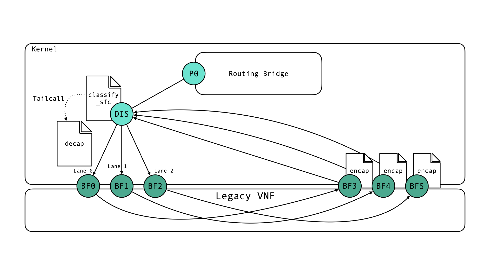
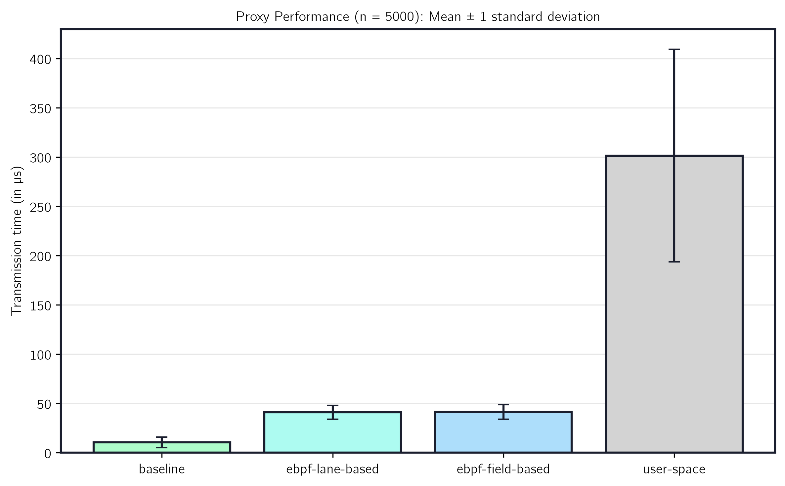

# SRv6 Proxy eBPF

We build two different version of a proxy. One uses the `fromVNF` interface to assign a service chain to returning non-SRv6 traffic (*lane-based*) and the other uses immutable header fields to distinguish between service chains (*field-based*).

## Lane-Based SRv6 Proxying
This SRv6 proxy implementation in eBPF uses several XDP programs.
It implements a dynamic proxy and matches return traffic based on the return interface (fromVNF). The proxy needs to be configured with a set of interface pairs, one `toVNF` and one `fromVNF`. Each tuple represents a lane. One lane isolates one SRv6 context at a time. The context is needed to correctly re-encapsulate packets. A major strength of lane-based proxying is that it puts no restriction on what NFs can change within packet headers.
It is important that the mapping between interface tuples is correct: the VNF must adhere to the mapping (i.e. forward traffic received from `toVNFi` to `fromVNFi`), and the eBPF maps need to be correctly populated from user space. Maps are used by the ingress pipeline (`toVNF`) to identify the correct link index to redirect a packet to (requires correct map: $lane \rightarrow linkIndex$). The lane is assigned based on SRH properties, the segment list in particular.
The inner packet is not touched and forwarded and reencapsulated as is.
The egress pipeline (`fromVNF`) retrieves the correct lane (which encodes the lookup key for the cached IPv6+SRH) from an eBPF map based on the interface a packet is received on. Note that the incoming interface is determined by the redirect decision made by the ingress pipeline (`toVNF`). A map ($linkIndex \rightarrow lane$) is required to map the link index of the receiving interface to the correct lane.
Three XDP programs are used to classify, decapsulate and re-encapsulate SRv6 traffic traversing the proxy.
### Setup
To test the proxy, build and run `cmd/main.go` with `--lane-based=true`. This will set up a routing bridge, several veth-interface pairs cosplaying as legacy VNFs, and a veth pair connecting a dispatcher to the routing bridge (one peer is enslaved to the bridge).
> Note that when using veths, XDP might not be advertised/enabled, which would lead to `xdp_redirect` errors. To make a veth-peer (e.g. the dispatcher veth-peer) accept XDP redirects, one can enable `gro` on the other veth-peer using `ethtool`. 
> Enabling gro creates a ring buffer and NAPI instance, into which the XDP redirect buffer can be written and be consumed by.

The main program loads the eBPF collections and attaches them to the correct interfaces.
It also populates maps with the correct information. For testing/development the coupling of interfaces is decided from the order in the interface declaration in `main.go`.


### Testing
To see the proxy in action, listen with `tcpdump` on the veth peer attached to the bridge and send SRv6 packets using scapy.
```
p = Ether()/IPv6(src="2001:db8:1::1", dst="2001:db8:2::1")/IPv6ExtHdrSegmentRouting(addresses=["2001:db8:3::1","2001:db8:2::1"], segleft=1, lastentry=1)/IPv6(src="fd00::1", dst="fd00::2")/ICMPv6EchoRequest()
sendp(p, iface="routing-br-port")
```

#### Troubleshooting
If no traffic arrives, the XDP redirect might fail. Check with `sudo bpftrace -e 'tracepoint:xdp:xdp_redirect_err {printf("redirect_error")}'`. Enabling gro on the veth-peer enslaved to the routing bridge might solve it.
If IPv4 traffic is dropped, check `rp_filter` and `accept_local` for interfaces involved.
### Programs
#### `classify_sfc`
This program is the entry point into the toVNF ingress pipeline. It classifies the packet into a lane and passes this decision to the decap program via packet meta data and a tail call.
The tail call is also used to reduce complexity in the decap program.
The classification mechanism uses a cache, storing the segments characterizing a service chain, and compares the SRH of incoming packets with the cached per-lane entries. If one entry matches, it puts the incoming packet into the same lane.
If a free lane is encountered, the packet is put there immediately to maximize utilization.
If all lanes are occupied, the lane with the oldest SFC is evicted and the new packet assigned to its lane.
We use `bpf_jiffies64()` to store packet age.
After determining a lane, the packet is passed to the decap program (using a tailcall) passing the assigned lane along in `xdp_md.data_meta`.
In the test environment the `classify_sfc` program is attached to the dispatcher veth peer.
#### `decap`
The `decap` program decapsulates the packet, updates, and caches the header. It also updates the ethernet header to be addressed to its corresponding `fromVNF` interface. Otherwise the packet might be dropped if the interface is not in promiscuous mode.

#### `encap`
The `encap` program looks up the correct lane (and header to put back on the packet) based on the interface index on which the packet is received.
It fetches the cached header, copies it in front of the inner packet and updates fields int the ethernet header and SRH to match the inner packet.
It then redirects the packet through the dispatcher veth peer, which leads to the packet being received by the routing bridge.

> `bpf_redirect()` in XDP only supports emitting packets on the egress queue of interfaces, hence "redirecting" a packet means "putting it out through". In TC, packets can be directly redirected to the ingress queue of another interface.


## Field-based SRv6 Proxying
One inherent limitation of the lane-based proxying is that it only supports $n$ SFCs being in flight at the same time. For this it requires $2n$ interfaces. While the amount of interfaces can be artifically increased by using e.g. SR-IOV, the total number is usually limited. 
Working around this limitation requires to change the way the SRv6 context is reconstructed in the proxy egress. Lane-based proxying uses the return interface to isolate the context, which couples the amount of supported SFCs (at the same time) and the number of required interfaces.
Differently, field-based proxying reconstructs context from a set of header fields ($S_{sfc}$) in the inner packet. The combined values in $S_{sfc}$ must uniquely identify each service chain. Additionally, we have to assume that the NF does not modify any fields in $S_{sfc}$; they are considered immutable.
While this puts more restrictions on the NF, it also enables support for way more service chains (that is, packets from more service chains being in flight at the same time). 
For Legacy VNFs, e.g. firewalls, which do not modify packets, but only drop or forward them, this might be a fitting mode of operation. Non-SRv6-capable programmable targets might also benefit from this, if the deployed NF does not modify $S_{sfc}$.
The basic functioning of a field-based proxy is the following: When a packet is received, the packet is decapsulated and $S_{sfc}$ is retrieved from the packet. Then a key is calculated from $S_{sfc}$, which is used to store the decapsulated header in a shared cache (e.g. an eBPF map). Note that the key is calculated from fields in $S_{sfc}$, which are guaranteed to not be modified (and received) by the egress pipeline. After storing the header, the inner packet is forwarded to the legacy VNF. 
On return traffic, the egress component parses $S_{sfc}$ and calculates the key. The key is used to look up the cached header. It reassembles and forwards the SRv6 packet.
This is an elegant solution, if a set $S_{sfc}$ exists. If it does not, lane-based proxying can still be used.

### Setup 
Build and run `cmd/main.go` with `--lane-based=false`. This sets up interfaces simmilar to the setup described for lane-based proxying. Consult the source code in `main.go` for names of interfaces etc.
Same as above, veth pairs might need to have one end with enabled `gro` (use `sudo ethtool -K <iface> gro on` to enable) to accept XDP redirects.
Note that there is one set of send/receive interfaces only.

### Programs
For our implementation, we limit the support of inner L3 and L4 protocols to IPv4, IPv6, UDP, TCP. The prototype can be easily extended to support more.

#### `proxy_ingress`
The first program parses the inner L3 header and retrieves the fields in $S_{sfc}$ being part of the L3 header. It computes a partial key from those and passes it on to the next eBPF program, which is picked based on the version of the inner L3 packet and the next_proto field (`protocol` or `nexthdr`). `proxy_ingress` picks the next program, makes a tailcall and writes the (potentially partial) key to the buffer's metadata.

#### Protocol-dependent L4 parsing programs
To make the proxy more modular and avoid too many checks based on IP version and L4 protocol, we create one eBPF program for each combination of L3/L4 we currently support (`tcp_in_ipv4`, `tcp_in_ipv6`, `udp_in_ipv4`, and `udp_in_ipv6`). The program can be extended to support more protocols by adding more of those functions and adapting the switching logic in `proxy_ingress`.
Each of the programs parses L4 fields in $S_{sfc}$ and completes key calculation. Each program then makes a tailcall to the generic `decap` xdp program, which performs packet decapsulation, header caching and redirecting the packet.

#### `decap`
The `decap` program decapsulates the packet, updates, and caches the header. It also updates the ethernet header to be addressed to its corresponding `fromVNF` interface. Otherwise the packet might be dropped if the interface is not in promiscuous mode.

#### `proxy_egress`
The return traffic (`fromVNF`) is received by the `proxy_egress` program, which computes the key in the same way as above (without using protocol dependent L4 parsing programs), fetches the cached header and reencapsulates the packet.

### Idealized Flow
We imagine the proxy to be integrated in a K8s-native framework like Loom. The user should be free of having to pick proxy implementations and deploying them manually. If a user has a Non-SRv6 capable VNF, he should add it to Loom by declaring a custom resource type for this VNF (e.g. create a `Bluefield3Target`). When doing this, the user should specify if a proxy is needed, which interfaces belonging to the VNF can be used by a proxy component. 
When deploying a network function, which should be running on the created target, the user can specify a proxy mode, which fits the NF. If the user knows, that the NF is a firewall, which does not modify packets and that service chains are uniquely identified by (SRC, DST) of the L3 packet, he can declare so in the NFs Spec.

```
kind: NetworkFunction
...
proxy:
    strategy: fields-based
    fields:
        - proto: PROTO_IPv4
        field: IPv4_SRC_ADDR
        match:
            type: EXACT_MATCH
      - proto: PROTO_IPv4
        field: IPv4_DST_ADDR
        match:
            type: EXACT_MATCH
```
If the service chain is not identified by an exact header match field alone, the user can specify an arbitrary bit map to specify which fields to use to compute the key. For example, to match on the `/24` src subnet instead of one particular IP, this could be used.

```
kind: NetworkFunction
...
proxy:
    strategy: fields-based
    fields:
      - proto: PROTO_IPv4
        field: IPv4_SRC_ADDR
        match:
            type: BITMASK_MATCH
            bitmask: "0xffffff00"
      - proto: PROTO_IPv4
        field: IPv4_DST_ADDR
        match:
            type: EXACT_MATCH
```
This would entail that packets `10.0.10.1 > 10.0.0.1` and `10.0.10.2 > 10.0.0.1` would be classified into the same SFC. Bitmask matching can be used to match flexibly on any header field. The broad option to specify bitmasks can be extended to make it more usable, e.g. by offering an match types to specify a subnet (`/24`), which could be translated easily into a bitmask. Exact matching for example is just a special case of bit masking (bitmask match, where the mask for the complete header field consists of 1's).

The user can then go on and use the deployed (not SRv6-capable!) target in his service chains and loom (or any other framework depending on SRv6 processing by VNFs) will work like before.
 > For a framework like IML/Loom, it is impossible to know, how user NFs will change fields or how NFs can expose interfaces, so it is desirable to let the user (who knows the NF's functioning and capabilities), which proxy mode to choose.
> We want to offer this flexibility in Loom by letting users configure proxy behavior in the `Spec` of a NF.

### Key Calculation
The key is calculated using bitmasks provided by the user space loader. The masks are computed from the yaml configuration in the NF Spec. The masks are stored in eBPF maps and are retrieved by the decap and encap routines. If the inner L3 header is IPv4, the bitmask for IPv4 is retrieved and applied to the parsed header. Masked headers of L3 and L4 are combined to form the lookup key.

## Performance
We evaluate the userspace and eBPF proxy variants using the evaluation script described in detail [here](../experiments/code/README.md). We run experiments on an x86_64 host with 8 CPUs (AMD Ryzen 5 Pro 2500U) with Ubuntu 26.04.1 LTS (Kernel 7.0.0-38-generic).
The baseline measurements is the transmission delay of a veth pair without any proxying or additional packet processing. For the other conditions, we send SRv6 traffic through a veth pair but with the proxy in fornt of it. The proxy always decapsulates and re-encapsulates after the reception time is taken.
In order to simulate the Loom environment, we send traffic on an interface attached to a central routing bridge, mirroring Loom's networking architecture.

We use a scenario with 10 different service chains for the eBPF implementation and a scenario with one service chain for the user space implementation.

The eBPF proxy solutions have similar means, but differ significantly (field-based=41.32µs, lane-based=40.89µs, p=0.016). Both are significantly faster than the userspace implementation (mean=301.5µs).


