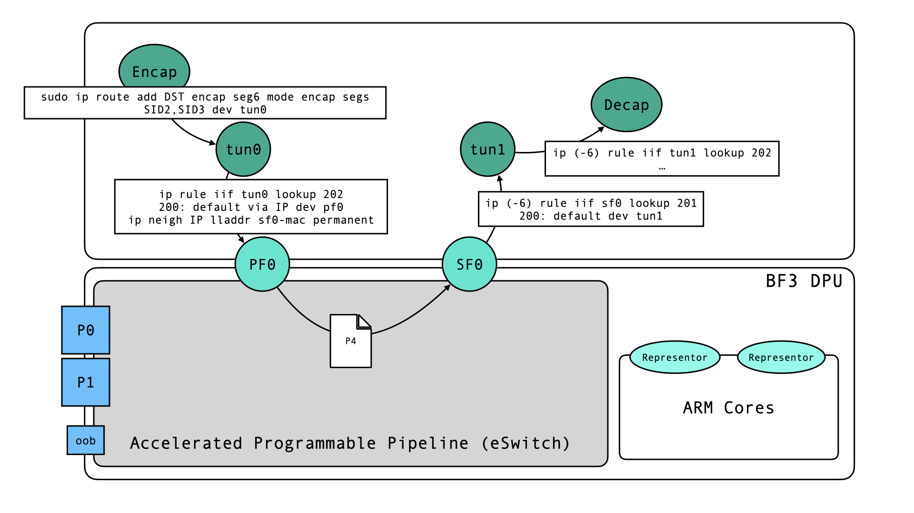

# SRv6 Proxy for Loom



## Design
The proxy runs two go routines, one for decapsulation, one for encapsulation. They share a header cache, which is updated on each packet.
The tunnel device `tun0` owned by the decapsulation routine is used to read and write packets from/to the kernel IP stack. A route is used to to route packets to an SID prefix through `tun0`.
`tun0` parses the header, updates it (decrements the `segmentsLeft` field and updates the destination address with `segmentList[segmentsLeft]`). The updated header is stored in a shared cache.
Policy routing is used to route packets to the physical function netdevice interface, which is directly connected to the switching pipeline (the host-representors on the ARM subsystem are skipped!). The P4 Program manages the switching behavior and puts out packets arriving on the host interface representing a scalable PCIe function (see https://networking-docs.nvidia.com/doca/archive/3-4-0/bluefield-scalable-functions).
Policy routing is again used to send packets from the incoming interface directly to `tun1`, whose owning go routine re-encapsulates the packet and re-enters it in the kernel stack from `tun1`. Again, using policy routing the packet is forwarded to a decap interface (for testing) or further routing.
Notably, the proxy does not manage how packets enter the SRv6 domain and how encapsulated packets are routed to the actual location instead of reentering the SRv6 domain.

## Routing Configuration
All routes configured are mentioned here. Routes for testing/development are tagged with #development.

- #development encap route to generate SRv6 traffic
```
sudo ip route add 10.50.0.0/30 encap seg6 mode encap segs fd00::2,fd00::3 dev tun0
```
- rule/route/mac-addr for `tun0`-> `enp94s0f0np0`(host netdev of physical function)
```
ip -6 route add fd00::/64 dev tun0 # needed that encapsulated packets find tun0
ip rule add iif tun0 lookup 200
ip route add default via 10.0.0.1 dev enp94s0f0np0 table 200
sudo ip neigh replace 10.0.0.1 lladdr 02:00:00:00:00:05 dev enp94s0f0np0 nud permanent
```
- rule/route for return traffic: `sf0` (host side scalable function netdev) -> `tun1`
```
ip rule add iif enp5es0f0s5 lookup 201
ip route add default dev tun1 table 201
```
- #development route to decap interface (vrf) with End.DT4 or End.DX4 action
```
ip -6 rule iif tun1 lookup 202
sudo ip -6 route add fd00::3/128 table 202 encap seg6local action End.DT4 vrftable 254 dev decap4 # vrf needs to be created first
```
## Host Configuration
The routing behavior is asymmetrical and sometimes considered invalid.

### RP filter
The reverse-path filter looks up the source IP in the FIB and checks whether it has a route to the source IP (in case `rp_filter=2`), and if the outgoing interface matches the incoming interface of the packet (in case `rp_filter=1`). Otherwise the packet is dropped. Depending on the actual IPs used, this might have to be disabled on the host and interfaces to allow for this routing.
```
net.ipv4.conf.{all,tun0,tun1,...}.rp_filter=0
```
Can be avoided if all addresses used as source addresses are valid and have a corresponding route in the FIB. #development 
### Martian Addresses
Here martian addresses are relevant, where the sourceIP of an IP packet is local (might hint to spoofing). Per default, interfaces are configured to drop them. For our routing, at least the interfaces towards the Bluefield and `tun0`+ `tun1` need to accept local source addresses.
```
net.ipv4.conf.{tun0,tun1,...}.accept_local=1
```
`tun0` might receive SRv6 packets with local SA, if the encapsulation happens on the host. The decapsulated package reentering on `tun0`and `pf0` might have local SA's. 
This extends to `sf0` and `tun1`.
### Firewalls
Firewall default rules might drop forwarded packets if not explicitly allowing traffic forwarding from `tun0` -> `pf0`and `sf0`-> `tun1`

e.g.:

```
# FORWARD default is DROP
iptables -I DOCKER-USER 1 -i tun0 -o enp94s0f0np0 -j ACCEPT
iptables -I DOCKER-USER 1 -i enp5es0f0s5 -o tun1 -j ACCEPT
```

### Example PCAPs

- `tun0`: encapsulated packet enters -> reenters decapsulated
```
12:51:18.809866 IP6 2001:610:2d0:200:ae1f:6bff:fe5a:42d2 > fd00::2: RT6 (len=4, type=4, segleft=1, last-entry=1, tag=0, [0]fd00::3, [1]fd00::2) IP 145.100.131.34 > 10.50.0.3: ICMP echo request, id 36, seq 1, length 64

12:51:18.810094 IP 145.100.131.34 > 10.50.0.3: ICMP echo request, id 36, seq 1, length 64
```

- `tun1`: packet enters and gets re-encapsulated in tun1 (note the updated destination/segleft fields)
```
12:51:18.810209 IP 145.100.131.34 > 10.50.0.3: ICMP echo request, id 36, seq 1, length 64

12:51:18.810332 IP6 2001:610:2d0:200:ae1f:6bff:fe5a:42d2 > fd00::3: RT6 (len=4, type=4, segleft=0, last-entry=1, tag=0, [0]fd00::3, [1]fd00::2) IP 145.100.131.34 > 10.50.0.3: ICMP echo request, id 36, seq 1, length 64
```